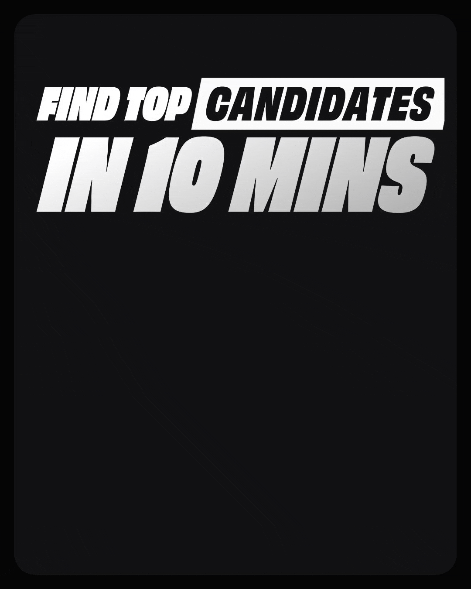

# Tal Boss: Hire in 10 Mins

The Remotion source for two Tal Boss ad creatives (1080×1350, 4:5), plus the final renders.

| Hire in 10 Mins | Find Top Candidates in 10 Mins |
|---|---|
|  |  |
| Comp `HireIn10BangaloreQuery` | Comp `FindTopAnyRole` |
| [GIF](renders/hire-in-10-mins.gif) · [MP4](renders/hire-in-10-mins.mp4) | [GIF](renders/find-top-candidates-in-10-mins.gif) · [MP4](renders/find-top-candidates-in-10-mins.mp4) |

The story: a hiring manager types the role ("Who are you hiring today?"), Tal runs the search (radar, live counters, stopwatch), and a shortlist of candidates who want to work with them is ready, with interviews booked, in under 10 minutes.

## Run it

```bash
npm install
npx remotion studio                       # preview every comp
npx remotion render HireIn10BangaloreQuery out/hire-in-10-mins.mp4 --crf=16
npx remotion render FindTopAnyRole out/find-top-candidates-in-10-mins.mp4 --crf=16
```

GIFs are made from the MP4 at 20fps, 1080 wide:

```bash
ffmpeg -i out/X.mp4 -vf fps=20 frames/f_%04d.png
gifski --fps 20 --width 1080 --quality 90 -o out/X.gif frames/f_*.png
```

Note: the radar run was sped up (`RUN_K = 0.65`) after the Hire in 10 render in `renders/` was made, so a fresh render of `HireIn10BangaloreQuery` comes out a little shorter.

## Fonts

Captions use **Obviously** (OH no Type Co), which is a licensed typeface and isn't included. Put these files in `public/fonts/`:

- `ObviouslyNarrowBold.otf`
- `ObviouslyNarrowBlackItalic.otf`
- `ObviouslyCondensedBlack.otf`

The big chrome title lockups are pre-rendered PNGs in `public/fig/k-*.png` (made with `tools/lettering.py`), so they don't need the font. Everything else uses Google Fonts (Inter, JetBrains Mono and others) through `@remotion/google-fonts`.

## What's where

- `src/HireIn10.tsx`: the main component. Props switch between versions: `city`, `query`, `role`, `hook`, `hookLayout`, `heroPhotos`, `bigHook`, `trio`, `stamp` and more.
- `src/Root.tsx`: every comp, including city cuts (Pune, Chennai, Bangalore), role cuts (`HireIn10Bangalore-<role>`, `FindTop-<role>`) and `FindTopAnyRole`.
- `src/roles.ts` and `src/findTop.json`: per-role copy, search query, tags and the three people shown.
- `public/fig/`: app screens exported from Figma (`s01`–`s14`) and chrome kit pieces (`k-*`).
- `public/people/`: candidate photos from Unsplash (free licence). The names are invented. See `public/people/CREDITS.txt`.
- `tools/lettering.py`: renders the chrome Obviously title lockups. `tools/role_hooks.py` builds them for each role.
